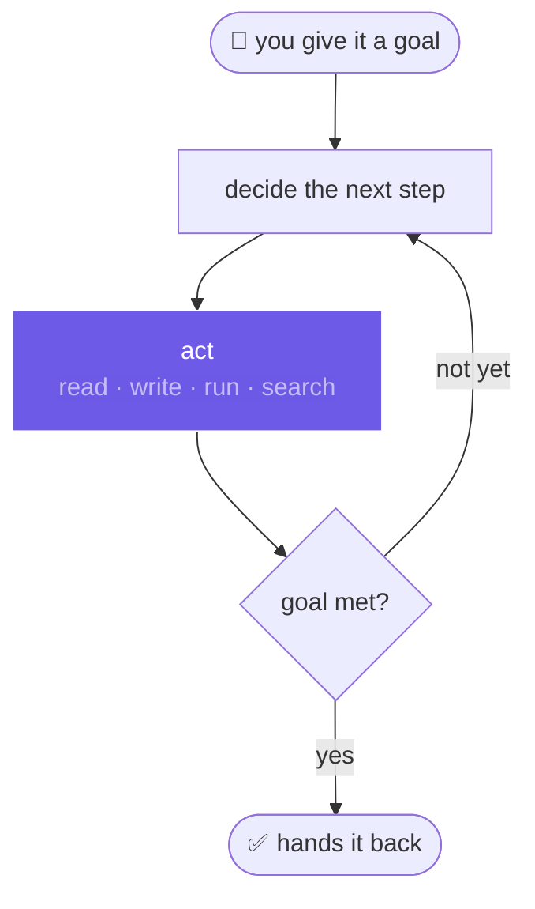
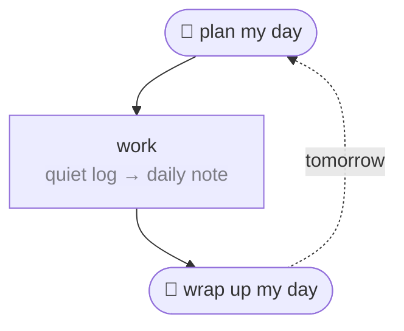
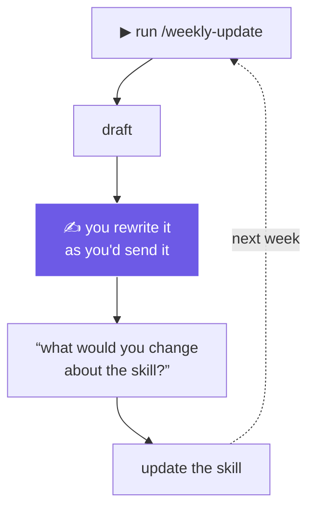
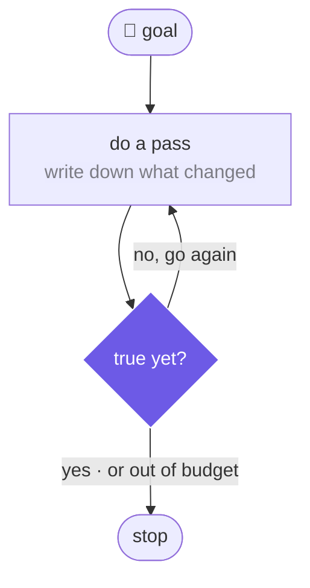
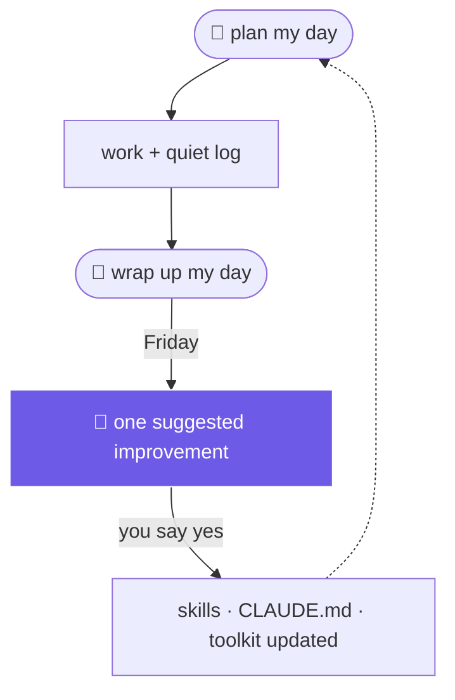
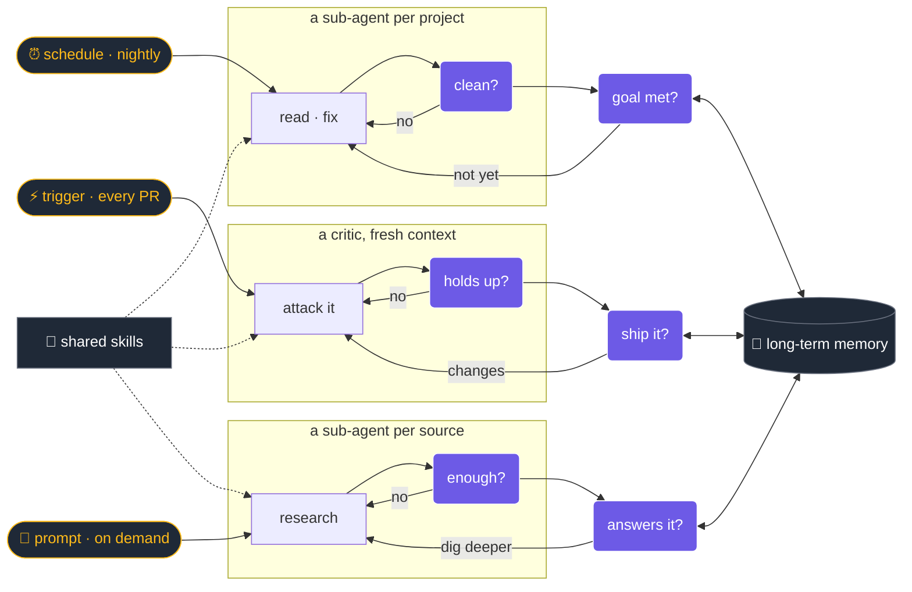
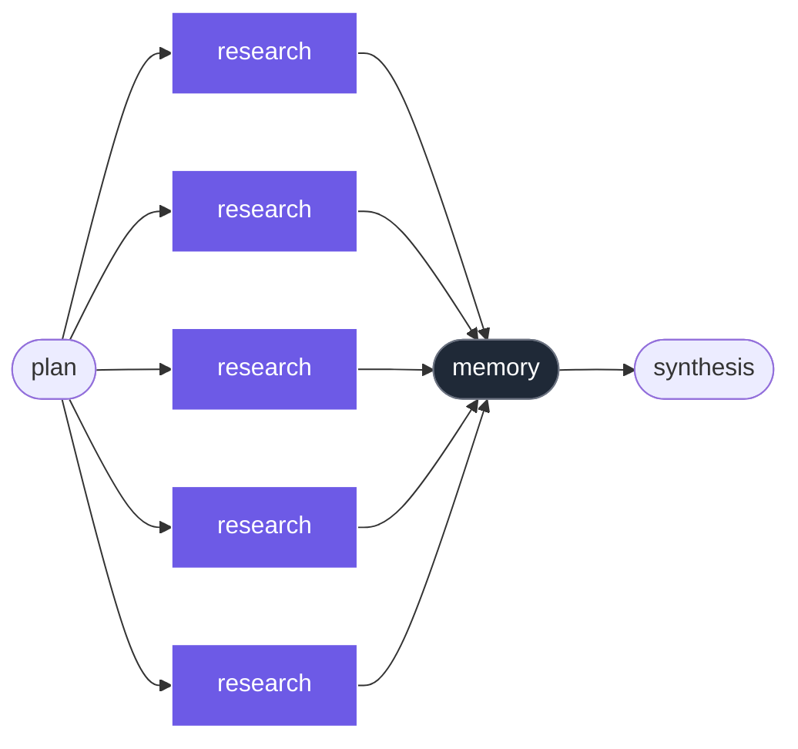

# Working with AI

### From better prompts to a full agentic system

<div class="pt-10 opacity-80">
Workshop for founders, operators &amp; builders
</div>

<!--
Intros round: name, one sentence on what you do, one sentence on what you use AI for today.

Quick hands up:
- Who has Claude Code (or Cursor/Codex) installed on their laptop?

Set expectations: this is a workshop, not a lecture. Every theme ends with a prompt you can paste today. Interrupt me.
-->

---
src: ../../about-me.md
---

---
layout: default
---

# How we got here

<div class="opacity-80 -mt-1 mb-3">Five shifts in four years. Each one kept the one before it.</div>

<div class="flex flex-col gap-2.5 text-sm">

<div v-click class="flex gap-4 items-baseline">
<span class="w-32 shrink-0 opacity-50 text-xs">2022 – 2024</span>
<span class="w-4 shrink-0 font-bold text-[#ffbb1a]">1</span>
<span><b>Prompt engineering:</b> <span class="opacity-70">humans write one-off prompts to guide a model through individual turns.</span></span>
</div>

<div v-click class="flex gap-4 items-baseline opacity-45">
<span class="w-32 shrink-0 opacity-60 text-xs">Nov 2024</span>
<span class="w-4 shrink-0"></span>
<span><b>MCP:</b> <span class="opacity-80">a protocol for writing "plugins" for our tools, so any model can use them.</span></span>
</div>

<div v-click class="flex gap-4 items-baseline">
<span class="w-32 shrink-0 opacity-50 text-xs">early 2025</span>
<span class="w-4 shrink-0 font-bold text-[#ffbb1a]">2</span>
<span><b>Agents:</b> <span class="opacity-70">saved prompts, and models that can use tools and act on their environment. Claude Code ships.</span></span>
</div>

<div v-click class="flex gap-4 items-baseline">
<span class="w-32 shrink-0 opacity-50 text-xs">Oct 2025</span>
<span class="w-4 shrink-0 font-bold text-[#ffbb1a]">3</span>
<span><b>Skills:</b> <span class="opacity-70">custom agents and saved prompts become re-usable skills, combined across sessions.</span></span>
</div>

<div v-click class="flex gap-4 items-baseline">
<span class="w-32 shrink-0 opacity-50 text-xs">2025 – early 2026</span>
<span class="w-4 shrink-0 font-bold text-[#ffbb1a]">4</span>
<span><b>Loop engineering:</b> <span class="opacity-70">autonomous cycles that re-prompt the model, check progress, and run to a stop condition. It started as a script that just re-ran the agent until the job was done.</span></span>
</div>

<div v-click class="flex gap-4 items-baseline">
<span class="w-32 shrink-0 opacity-50 text-xs">Mid-2026</span>
<span class="w-4 shrink-0 font-bold text-[#ffbb1a]">5</span>
<span><b>Graph engineering:</b> <span class="opacity-70">organisations of agents, each running its own loop, wired with dependencies, shared memory and evaluation edges.</span></span>
</div>

</div>

<!--
The dates are the point: prompt engineering is four years old, graph engineering is months old. Nobody in this room is behind.

MCP is greyed out deliberately. It matters enormously for plumbing, but it's the one stage we're not covering today, so don't get drawn into it. If someone asks: it's the reason your agent can talk to Slack or Postgres without anyone writing a bespoke integration for each.

Feb 2025 is Claude Code's research preview; it went GA that May.

The loop-engineering origin is Geoffrey Huntley's "Ralph loop" (2025), literally a shell script that re-invoked the agent in a while loop. Worth mentioning only if someone asks how homemade this all is; the name isn't important, the idea is.
-->

---
layout: section
section: Prompting
---

# 1 · Prompting

<div class="opacity-70">Get better work out of AI than you would without it</div>

<!--
All browser-based. Five techniques, each shown as a two-tab comparison: same task, with and without the technique.
-->

---
layout: default
---

# Set the bar before the work

<div class="opacity-80 -mt-1 mb-3">Ask what world-class looks like, <em>then</em> ask for the work.</div>

<div class="grid grid-cols-2 gap-5 items-start">

<div v-click>
<Snippet label="Bad · straight to work" tone="a">

I'm a *[your job title]* at *[where you work]* and I send a weekly status update to my CEO every Friday. Write me a hypothetical example of this status update.

</Snippet>
</div>

<div v-click>
<Snippet label="Better · define good first" tone="b">

**Before you write anything**: what does a CEO actually need from a weekly update? What are they scanning for, what makes them stop reading, and what's the difference between an update that gets skimmed and one that changes how they think about your team? Be specific.

**Think about world class CEOs and companies**: see if you can find real world examples of their internal comms.

*…then:* Now write a hypothetical status update based on what we just discussed.

</Snippet>
</div>

</div>

<div v-click class="takeaway">
<span class="lbl">Tip</span>
Bake real world examples into your prompts.
</div>


<!--
Cheapest quality upgrade there is. The model writes to the criteria it has just stated; without that step it writes to "generic status update".

Run the exercise: 4 minutes, walk the room, then two or three 20-second debriefs. No paid account handy? Do it live on screen and let the room call out what they notice.

The same move applies to anything: "what would an excellent X for this reader look like?" before "write X".
-->

---
layout: default
---

# Front-load context

<div class="opacity-80 -mt-1 mb-3">Context is the lever: <span class="text-sm opacity-90 mb-2">Like a new hire, AI is only as good as the context it has.</span>
</div>

<div class="grid grid-cols-2 gap-5 items-start">

<div v-click>
<Snippet label="OK · With your actual week" tone="a">
I want to spend more time on work that matters and less on low-impact work. What should I cut, change, or do differently?

**Here's how my time actually looked last week:** *[calendar screenshot, or 3 lines]*
</Snippet>
</div>

<div v-click>
<Snippet label="Better · Where do you spend the most time?" tone="b">
I want to spend more time on work that matters and less on low-impact work. What should I cut, change, or do differently?

**Here's how my time actually looked last week:** *[calendar screenshot, or 3 lines]*

**Look at last weeks' meeting transcripts**. Identify opportunities for improvement and what work would make the most impact.

**Run the same analysis on my claude transcripts from last week**

*[Write a workflow to coordinate this task.]*
</Snippet>
</div>

</div>

<div v-click class="takeaway">
<span class="lbl">Tip</span>
Enabling memory in Codex/Claude will automatically pull in relevant context.
</div>


---
layout: default
---

# Research
<div class="opacity-80 -mt-1 mb-3">Research before recommending</div>

<div class="grid grid-cols-2 gap-5 items-start">

<div v-click>
<Snippet label="RTO Mandate" tone="a">
<div class="text-sm opacity-90 mb-2">
My CEO and board want to enforce a return to the office but I'm afraid my team may quit. How should I approach this?
</div>
</Snippet>
</div>

<div v-click>
<Snippet label="Research first!" tone="b">

**Before we talk about what I should do**, do some research: which companies have done full RTO mandates recently, what actually happened (attrition, performance, morale), and what did the managers who navigated it well do differently from the ones whose teams fell apart?

*…then:* Now use that research to recommend how I should approach this.

</Snippet>
</div>
</div>


<div v-click class="takeaway">
<span class="lbl">Avoid Bias</span>
Without research it over-rotates on your framing.

With it, the recommendation stands on what has worked elsewhere.
</div>

---
layout: default
---

# Teach it your standards

<div class="opacity-80 -mt-1 mb-3">You don't want generic best practice, you want <em>your</em> taste. Examples beat adjectives.</div>

<div class="grid grid-cols-[1.25fr_1fr] gap-5 items-start">

<div v-click>
<Snippet label="Step 1 · examples → principles" tone="b">

Here are three examples of executive communication that I think are excellent. **What do they have in common?** Articulate the specific principles that make all three work. Be precise.

*Example 1 · CEO quarterly update: …*

*Example 2 · VP announcing a reorg: …*

*Example 3 · Director sharing a postmortem: …*

</Snippet>
</div>

<div v-click>
<Snippet label="Step 2 · apply them" tone="b">

Now write an update from the CEO about a quarter where we missed revenue by 8%. **Apply those principles.**

</Snippet>
</div>

</div>

<div v-click class="takeaway">
<span class="lbl">Skills</span>
Once the standard is explicit it's reusable: create a skill!
</div>


<!--
"Write it more crisply" doesn't work. Three concrete examples and "what do they have in common" does.

This is the seed of everything later: a skill is an explicit standard plus a workflow. The email style guide and the feedback drafter are both this move applied to your own output.
-->

---
layout: default
---

# The Swiss Cheese Check

<div class="opacity-80 -mt-1 mb-3">For work outside your expertise, where you're least able to spot a mistake.</div>
<div class="opacity-60 text-sm -mt-1 mb-3">No single check catches everything, so stack them.</div>

<div class="grid grid-cols-2 gap-4">

<div v-click>
<Snippet label="Check 1 · Confidence">

What's the probability that this recommendation is correct? What would make you more or less confident in it?

</Snippet>
</div>

<div v-click>
<Snippet label="Check 2 · Context">

Under what circumstances would this recommendation be wrong?

</Snippet>
</div>

<div v-click>
<Snippet label="Check 3 · Expert">

If a world-class expert in this subject reviewed this recommendation, what would they add or change?

</Snippet>
</div>

<div v-click>
<Snippet label="Check 4 · Verification">

How should I verify this? If I were to fact-check your recommendation on my own, what could I do?

</Snippet>
</div>

</div>

<!--
Example: a manager who has never done a PIP asking whether to put someone on one. Each check is a slice with different holes.

Save these four as a text expansion. Run them on the last important thing AI told you.
-->

---
layout: section
section: Agents
---

# 2 · Agents

<div class="opacity-70">So you never have to re-explain yourself</div>

---
layout: default
---

# What are agents?

<div class="opacity-80 -mt-1 mb-3">A chat answers your question. An agent is handed a goal and keeps going until it's met.</div>

<div class="grid grid-cols-[1.05fr_1fr] gap-6 items-start">

<div>

<div class="col-head neutral">The loop it runs</div>



</div>

<div>

<div class="col-head neutral">What you give it</div>

<div class="text-sm">
<v-clicks>

- **Context:** who you are, what you're working on, what "good" looks like
- **Tools:** what it's allowed to touch: your files, calendar, inbox, the web
- **Standing instructions:** the rules it follows without being asked

</v-clicks>
</div>

</div>

</div>

<!--
One of the very first tools that we saw is when the agent was writing to its own to-do list.
-->

---
layout: two-cols-header
---

# The context directory

::left::

<div class="pr-4">

```text
context/
├── CLAUDE.md            ← standing instructions
├── reminders.md         ← everything on your plate
├── email-style-guide.md ← how you actually write
├── me/                  ← goals, preferences.md
├── team/                ← one profile per person
├── my-manager/
├── projects/            ← scoped ideas, decisions
├── company-context/
└── daily-notes/2026/09-September/2026-09-10.md
```

<div class="text-sm opacity-60 mt-1">One folder on the Desktop. Point Claude Code at it every session. It grows over time.</div>

</div>

::right::

<div class="pl-4 border-l border-gray-500/40">

<Snippet label="Set it up">

Set up my context directory with the following folders: me/, team/, manager/, projects/, company/, daily-notes/.

**Ask me three questions** that will help you fill in the most important context. Save the answers in the right folders.

</Snippet>

<div v-click>
<Snippet label="Let it hunt for context">

Look through my Documents and Downloads folders and find one file that might be useful context about me or my work. Tell me what it is and ask if you should move it to the context directory.

</Snippet>
</div>

</div>

<!--
The tree is the end state after a month; on day one it's empty folders.

"Ask me three questions" is a pattern worth stealing: let the model interview you rather than guessing what it needs. You don't write a manual about yourself.

For our team: a repo's CLAUDE.md and docs folder, but for a person.
-->

---
layout: default
---

# Let's set it up

<div class="opacity-80 -mt-1 mb-10">Laptops open. We build the context directory together, right now.</div>

<div class="flex flex-col items-center justify-center gap-8 h-[62%]">

<div class="text-8xl leading-none select-none">🛠️</div>

<div class="w-[62%]" v-click>
<Snippet label="Run this">

Set up a context directory at *[~/work/context]* with folders for me/, team/, manager/, projects/, company/ and daily-notes/.

**Ask me three questions** that would help you fill in the most important context, then save my answers in the right folders.

Write a CLAUDE.md file with a brief summary of this 'personal-assistant' agent setup.

</Snippet>
</div>
</div>

<!--
Do it live on the screen as well, so anyone who falls behind can copy what you're doing.

The folders are empty and that's fine. The point is that it exists and Claude Code knows where it is. It fills up over the next few weeks.

Watch for people trying to write the perfect CLAUDE.md here. Let the model interview them instead; that's what the three questions are for.
-->

---
layout: two-cols-header
---

# Connect your tools, and sound like you

::left::

<div class="pr-4">

<div class="col-head neutral">Access is the multiplier</div>

<div class="text-sm">
<v-clicks>

- Calendar first, then inbox. Two minutes each via "Connect your apps"
- **You choose the level**: read-only, or read and write. Start where you're comfortable
- Make it **show the plan before it acts**: "Show me what the day looks like before you add anything"
- Read-only inbox is enough to find the emails you meant to reply to

</v-clicks>
</div>

<div v-click>
<Snippet label="Evening sweep, extended">

Check my email from the past 24 hours. Show me a numbered list of anything that might need a response. **Draft responses and leave them in today's daily note for me to review.**

</Snippet>
</div>

</div>

::right::

<div class="pl-4 border-l border-gray-500/40">

<div class="col-head neutral">Sound like you</div>

<div v-click>
<Snippet label="Style guide from evidence" tone="b">

Pull the last 30 emails I sent (skip one-liners and forwards). Look for patterns in how I write: greetings, sign-offs, sentence length, tone, words I use a lot, words I avoid, how I push back, how I say no. **Write me an email style guide** and save it as email-style-guide.md.

</Snippet>
</div>

<div v-click>
<Snippet label="Wire it in">

Update my CLAUDE.md so that whenever you draft an email reply for me, you first read email-style-guide.md and follow it.

</Snippet>
</div>

<div v-click class="text-sm mt-2 opacity-80">Skim the guide and edit it. It will sometimes overfit to a couple of emails.</div>

</div>

<!--
Access: same principle as permissions for coding agents. More access, more useful; you set the boundary.

Style guide: "teach it your standards" applied to your own writing. The difference between "sounds like an AI" and "sounds like me".
-->

---
layout: section
section: Skills
---

# 3 · Skills

<div class="opacity-70">Write the standard down once, then invoke it by name</div>

---
layout: two-cols-header
---

# What are skills?

<div class="opacity-90 mt-1 mb-3">A file with a name, a line saying when to use it, and the instructions you'd otherwise repeat every time.</div>

::left::

<div class="pr-5">

<div class="col-head neutral">~/.agents/skills/grill-me/SKILL.md</div>

```markdown
---
name: grill-me
description: Use when user wants to stress-test a plan,
or get 'grilled' on their design.
---

Interview me relentlessly about every aspect of this
plan until we reach a shared understanding.

[...]
```

</div>

::right::

<div class="pl-5 border-l border-gray-500/40">

<div class="col-head neutral">The two halves</div>

<div class="text-sm">
<v-clicks>

- **The description is the trigger.** It's how the agent decides to reach for this rather than winging it. Write it as *"use when…"*
- **The body is the standard.** Exactly what you'd say out loud if you were briefing someone, written down once

</v-clicks>
</div>

</div>

::bottom::

<div v-click class="takeaway">
<span class="lbl">Skills</span>
It's just a simple file that you can read, edit, and keep improving on.
</div>

<!--
Show the real file. It lands better than describing one. This is mine, unedited, and it is genuinely this short. Nobody needs a framework to write it.

The frontmatter description is the part people get wrong: it isn't documentation, it's the text the model matches against to decide whether to reach for the skill at all. Vague description, skill never fires.

Worth demoing live if there's time: run /grill-me on whatever the room is currently planning.

Callback to "Teach it your standards" in section 1: that slide ended with "create a skill". This is what that means.
-->

---
layout: two-cols-header
zoom: 0.9
---

# Fool me once

<div class="opacity-90 mt-1 mb-3">The first time, just do it. The second time, codify it!</div>
<div class="opacity-70 text-sm mt-1 mb-3">Let the model write it for you</div>

::left::

<div class="pr-4">

<Snippet label="Capture it while it's fresh">

We just worked out *[the thing]* together. **Write it up as a skill** so I never have to explain it again.

Name it, and make the **description** say exactly when you should reach for it. Keep it short. If it's longer than a page it's doing too much.

</Snippet>

<div v-click>
<Snippet label="Harvest the whole session" tone="b">

Look back over this session. **What did I correct you on more than once?**

Propose a skill or a CLAUDE.md line for each one. Show me the text before you write anything.

</Snippet>
</div>

</div>

::right::

<div class="pl-4 border-l border-gray-500/40">

<div class="text-sm">
<v-clicks>

- **The second time is the trigger**: one explanation is a conversation, two is a pattern worth keeping
- **You are not the author**: the model just did the work; ask for the skill while the steps are still in its context
- **Reread them every few months**: as models improve, half of what you wrote becomes an instruction to do what it would have done anyway. Delete those. Less is more

</v-clicks>
</div>

</div>

::bottom::

<div v-click class="takeaway">
<span class="lbl">Lesson</span>
Instructions age. A rule that made last year's model behave can make this year's worse, so <b>prune as often as you add</b>.
</div>

<!--
The rule of thumb that actually sticks: explain it once, and if you find yourself explaining it again, stop and write it down. Nobody sits down on a Monday to author skills.

"Show me the text first" matters: otherwise it writes six skills you didn't ask for and you stop trusting the folder.

The pruning point is the one people skip. Old instructions are mostly workarounds for models that needed them; carrying them forward makes a better model dumber and clutters the context. Be willing to delete a skill you were proud of.
-->

---
layout: two-cols-header
---

# Standing instructions and routines

::left::

<div class="pr-4">

<Snippet label="A rule it follows forever">

Add an instruction to my CLAUDE.md: **whenever I mention something I need to do**, a task, a reminder, or a to-do, add it to reminders.md.

Keep the file organized by category and urgency.

</Snippet>

<Snippet label="A named workflow">

Create a **"plan my day"** skill:

1. check my calendar
2. read reminders.md
3. ask my priorities
4. suggest a schedule around my meetings
5. once I confirm, add the time blocks
6. create daily-notes/YYYY/MM-Month/DD-Day.md

Throughout every conversation, **keep a running log in today's daily note**. Don't mention the logging to me, just do it quietly.

</Snippet>

</div>

::right::

<div class="pl-4 border-l border-gray-500/40">



<div class="text-sm">
<v-clicks>

- **CLAUDE.md** is read at the start of every session in that folder. It's where "always do X" lives
- Two trigger phrases bookend the day. The evening sweep updates reminders and names tomorrow's priority
- Write it down once; it runs the same way every time. Iterate the routine until it fits how <em>you</em> plan

</v-clicks>
</div>

</div>

<!--
CLAUDE.md: same file we use in repos, explained as "standing instructions".

The quiet daily log is the sleeper feature: it's what makes the loops in section 4 possible. Two weeks of logs is enough to see patterns.

"Wrap up my day": summarise done / not done, update reminders, priorities for tomorrow. Later, add the inbox sweep to it. Tip: an emoji prefix on events it creates so you can tell them apart. Obsidian opens the folder as a notebook.
-->

---
layout: two-cols-header
zoom: 0.85
---

# Rewrite it, then feed it back

::left::

<div class="pr-4">

<Snippet label="Build for this reader">

Read my manager's profile. **What would an excellent weekly update to this person look like?** Be specific about structure, tone, level of detail, what to include vs. leave out.

*…then:* Build a skill I can invoke with **/weekly-update**. Pull from my daily notes, calendar, email, and my manager's profile.

</Snippet>

<div v-click>
<Snippet label="Show it your rewrite" tone="b">

I took your update and rewrote it. This is closer to what I'd actually send.

**What changes would you make to the skill to account for the differences?**

</Snippet>
</div>

<div v-click>
<Snippet label="Make it grade itself" tone="b">

Run the skill we built. After you produce the output, grade yourself: what did you get right, what's off, what would you change about the skill to do better next time? **Then make those changes.**

</Snippet>
</div>

</div>

::right::

<div class="pl-4 border-l border-gray-500/40">



</div>

::bottom::

<div v-click class="takeaway">
<span class="lbl">Lesson</span>
<b>Show the fix</b>, then ask what the skill should change about itself. v1 is a draft; v3 or v4 works.
</div>

<!--
The most important loop in the deck. You're better at editing than at specifying: rewriting is fast and concrete. Asking the model to diff your version against its own and propose changes to the SKILL (not the output) is what makes the improvement permanent.

Self-grading is the cheap first pass; your rewrite catches the taste misses. Both feed the skill.

Engineering parallel: fix the generator, not the generated file.
-->

---
layout: default
---

# Community skills

<div class="opacity-80 -mt-1 mb-4">A lot of people publish their skills. Look there if you need inspiration</div>

<v-clicks>

- **Skills Marketplace** by Vercel: `https://skills.sh`
- **Official Anthropic skills**: `https://github.com/anthropics/skills`

</v-clicks>

<div v-click class="takeaway">
<span class="lbl">Security tip</span>
Read before you install
</div>


<!--
Tagline on the site is "the open agent skills ecosystem". Skills are a format, not a Claude feature. That's the reason a directory can exist at all.

Browse it in the break. The useful move is reading a few good ones to see how other people write them, not installing twenty.

The security point is real and worth saying out loud: a skill is prose that steers your agent, and it can ask it to run things. Treat an unknown skill like an unknown npm package. The site has an audits section for this reason.
-->

---
layout: section
section: Loops
---

# 4 · Loops

<div class="opacity-70">Describe the goal -> define the system -> review the outcome</div>

---
layout: default
---

# What are loops?

<div class="opacity-80 -mt-1 mb-3">A prompt says <i>do this next thing</i>. A loop says <i>keep going until this is true</i>.</div>

<div class="grid grid-cols-[1fr_1.05fr] gap-6 items-start">

<div>

<div class="col-head neutral">Four things make it a loop</div>

<div class="text-sm">
<v-clicks>

- **A goal:** an outcome, not a task. *"my inbox is at zero and nothing important is unanswered"*
- **A trigger:** a time, an event, or a phrase you say. *"wrap up my day"*
- **A way to check:** after each pass, something decides whether the goal is true yet
- **A point where it stops:** done, out of budget, or no longer making progress

</v-clicks>
</div>

<div v-click class="text-sm mt-3 opacity-90">Each pass leaves something behind: your notes, the plan, the skill itself. The next one doesn't start from scratch.</div>

</div>

<div>

<div class="col-head neutral">What it looks like</div>



</div>

</div>

<!--
The shift to land: you stop being the person who prompts, and become the person who writes down what "done" means. That's the whole section.

Two of the four are the ones people forget. The check: without it the thing runs forever and nobody notices. And the stop: decide it before you start, not when the bill arrives.

The goal has to be checkable. "Make it better" isn't a goal; "every unanswered email older than three days has a reply or a reason" is.

Ask the room: what would pass #10 know that pass #1 didn't? If the answer is nothing, it isn't a loop.
-->

---
layout: two-cols-header
---

# Repeatable learning

<div class="opacity-90 mt-1 mb-3">At its simplest, loops are just prompts running on a recurring schedule</div>

::left::

<div class="pr-4">

<Snippet label="After two weeks of daily notes">

Read all my daily notes, my reminders, my calendar from the past two weeks, and my CLAUDE.md. I want you to be honest with me:

1. What am I spending my time on vs. what I say my priorities are? Do those match?
2. What keeps showing up on my reminders list that I never get to?
3. What patterns do you see in how I work that I might not notice myself?

</Snippet>

</div>

::right::

<div class="pl-4 border-l border-gray-500/40">

<div v-click>
<Snippet label="Observed, not declared" tone="b">

Based on everything you've observed, write a preferences doc for me and save it to me/preferences.md. **Don't ask me what my preferences are. Tell me what you've observed them to be.**

Then add to CLAUDE.md: "For tasks involving how I work, communicate, or plan, read me/preferences.md first."

</Snippet>
</div>

<div v-click class="text-sm mt-3 opacity-90">

It has the data without the blind spots. Correct what's off, confirm what resonates. This is what the quiet daily log was for.

</div>

</div>

<!--
The payoff of the boring infrastructure: daily notes, reminders, calendar. Dependency chain: quiet log → mirror → backlog of things to build → weekly improvement.

Engineering version: ask it to read two weeks of commit messages and PR reviews and tell you what you keep re-doing.
-->

---
layout: two-cols-header
zoom: 0.9
---

# Make the system self-improving

::left::

<div class="pr-4">

<Snippet label="CLAUDE.md · Weekly improvement" tone="b">

Every friday review my daily notes from the past week, my skills, my preferences, and my reminders.

Recommend **one specific improvement** to the system: a skill to tweak, a preference that's changed, a workflow that's not working, a new tool for my toolkit, or something else worth building.

**Keep it to one suggestion.** Explain why, and wait for me to say yes before making any changes.

</Snippet>

</div>

::right::

<div class="pl-4 border-l border-gray-500/40">



</div>

<!--
Design details worth copying: one suggestion (not a list), with reasoning, and a human gate. That's what makes it sustainable.

Try the one-off version first: "Read my daily notes from the past few weeks, my skills, and my preferences. What's one thing you'd change about the system?"
-->

---
layout: default
---

# Group exercise

<div class="opacity-90 text-xl -mt-1 mb-3">⏱ <b>Five minutes</b></div>

<div class="flex flex-col items-center justify-center gap-8 h-[62%]">

<div class="text-8xl leading-none select-none">🤝</div>

<div class="text-lg">
<v-clicks>

1. Grab your neighbour.
2. Discuss your work habits.
3. Write down **2-3 loops** that would improve your day to day.
4. For each one, say the **trigger**, the **job**, and the **write-back**
5. Present your five back to the room

</v-clicks>
</div>

</div>

<!--
Five minutes really is enough. The constraint is what stops them designing one perfect loop instead of five rough ones.

Walk the room. The common failure is pure reminders with no write-back; push on "what changes as a result?" when you hear one.

Prompts for anyone stuck: what do you do every week that you'd want done the same way every time? What decision do you keep making from scratch? What falls through the moment the week gets busy? What would you want to be told on a Friday afternoon?

Collect the best two or three on a whiteboard as they present. They're the backlog for section 6.
-->

---
layout: two-cols-header
zoom: 0.85
---

# LLM as a judge

<div class="opacity-90 mt-1 mb-3">A goal only works if something can tell you it's met.</div>
<div class="opacity-70 text-sm mt-1 mb-3">Not every task is deterministic so usually it's a second model with a rubric.</div>

::left::

<div class="pr-4">

<Snippet label="1 · Write the judge" tone="a">

You are **Steve Jobs** reviewing this landing page. Score it **out of 100** on typography, spacing, hierarchy and restraint.

Name the single highest-value fix. You did not design it. No encouragement.

</Snippet>

<div v-click>
<Snippet label="2 · Loop against it" tone="b">

Redesign, screenshot it, send it to the judge, apply its top fix. Repeat.

**Stop at 80**, after ten rounds, or when two rounds in a row don't move the score.

</Snippet>
</div>

</div>

::right::

<div class="pl-4 border-l border-gray-500/40">

<div class="col-head neutral">What counts as "done"?</div>

<div class="text-sm">
<v-clicks>

- **Something you can measure:** *"every test passes"*, *"the page loads in under two seconds"*. Unambiguous, and rarer than you'd think
- **Something you can only judge:** *"a designer would ship this"*, *"my manager wouldn't ask a follow-up"*. Most real work lives here

</v-clicks>
</div>

<div v-click class="mt-4">

```bash
/goal landing page scores 80+
```

<div class="text-sm opacity-80 mt-1">Codex holds the objective across turns and counts tokens against a budget. Claude Code has <code>/loop</code>.</div>

</div>

</div>

::bottom::

<div v-click class="takeaway">
<span class="lbl">💡 Idea</span>
Write an A/B test agent workflow that continuously runs experiments for your business
</div>

<!--
The honest version of this: deterministic goals are the ones everyone reaches for and almost nobody has. "Tests pass" is a real goal; most of your week isn't shaped like that.

Steve Jobs is a device, not magic: a named, opinionated persona gives you a consistent grader. Any strong point of view works; what breaks it is "rate this out of 10" with no criteria.

Why 80 and not 100: the last twenty points cost more than the first eighty and the judge gets less reliable up there. Pick a number you'd actually accept and stop.

The judge needs its own context. A model scoring its own work grades generously. Same rule as the adversarial slide in the next section.

/goal is a Codex feature: a persisted objective per thread with a token budget and pause/resume/clear. Say that out loud in a Claude Code room.

Cost: unattended loops are cheap to start and expensive to forget about.
-->

---
layout: section
section: Graph engineering
---

# 5 · Graph engineering

<div class="opacity-70">Wire agents together: dependencies, shared memory, evaluation edges</div>

---
layout: default
class: graph-slide
---

# What is graph engineering?

<div class="graph-canvas">




</div>

<!--
This is the newest idea in the deck and the least settled. Say so: months old, not years.

The picture is the argument. Three ways in, and none of them is "the" entry point: a schedule, an event, you typing. Each runs its own loop, and inside each loop the work is itself a loop: a sub-agent with a fresh context going round until its own small goal is true. Loops inside loops.

Three kinds of wire hold it together:
- Dependencies: what has to finish before the next thing starts.
- Shared memory: the files every agent in the graph can read and write. That's the store on the right, and it's what makes tonight's run smarter than last night's.
- Evaluation edges: an agent whose only job is to judge another's work. That's the critic in the PR lane.

The skills box on the left is the other half of the point: one skill folder serves all three entry points. You write down how you review a PR once, and the scheduled run, the trigger and your ad-hoc prompt all use it.

Worth saying out loud if it comes up: the lanes aren't sealed off from each other. The nightly run opening a PR is the trigger lane's entry point. Drawing that edge made the picture unreadable, so say it instead.

You stop writing one long prompt and start deciding who does what, in what order, reading what.

If someone asks how this differs from a workflow: a workflow is a graph you drew by hand and run start to finish. The interesting part is when the nodes are themselves agents with their own loops, and the graph decides what they read.

The two slides after this are the two edges people get most value from straight away: dependencies (staged pipeline, files as the handoff) and evaluation (a critic with a fresh context).
-->

---
layout: two-cols-header
zoom: 0.9
---

# Break it into stages

<div class="opacity-90 mt-1 mb-3">The bigger the task, the worse one long chat performs. Give each stage a clean context and pass state in files.</div>

::left::

<div class="pr-4">

<div v-click>
<Snippet label="Fan out" tone="b">

Research *[the topic]* across *[these five sources]*.

**Run one agent per source**, each writing what it found to `research/<source>.md`. Then read all five and write me one synthesis.

**Call out where they disagree** instead of averaging them.

</Snippet>

<div>

Use `/batch` in Claude Code

</div>
</div>
</div>

::right::

<div class="pl-4 border-l border-gray-500/40">



</div>

::bottom::

<div v-click class="takeaway">
<span class="lbl">Tip</span>
Delegate complex tasks to multiple agents, let the agent write the prompts.
</div>

<!--
This is the "[Write a workflow to coordinate this task]" line from the front-load context slide, cashed out properly.

Two shapes on one slide: the pipeline (each stage feeds the next) and the fan-out (many agents in parallel, one synthesis). Migrations and big refactors are the pipeline; research and due diligence are the fan-out.

The files are the point. "Stop at the first failure" is what keeps a long unattended run from quietly doing forty wrong things.
-->

---
layout: two-cols-header
zoom: 0.85
---

# Adversarial AI

<div class="opacity-90 mt-1 mb-3">Ask "is this any good?" and it will agree with you. Give it a role whose job is to find the holes.</div>

::left::

<div class="pr-4">

<Snippet label="1 · Propose" tone="c">

Here's what we're planning to do: *[the plan]*. Write it up properly: the approach, the sequence, and what we're betting on.

</Snippet>

<div v-click>
<Snippet label="2 · Attack it" tone="b">

**In a new session, as a skeptical *[staff engineer / CFO / head of security]*** whose job is to stop bad plans: you did not write this. Find the **three most likely ways it fails**, ranked. For each, the evidence you'd need to confirm it and what it costs us to find out late.

</Snippet>
</div>

<div v-click>
<Snippet label="3 · Reconcile" tone="b">

Here are the critiques. Revise the plan to address the ones worth addressing, and **list the ones you're deliberately ignoring, and why.**

</Snippet>
</div>

</div>

::right::

<div class="pl-4 border-l border-gray-500/40">

<div class="col-head neutral">Where it earns its keep</div>

<div class="text-sm">
<v-clicks>

- **Planning:** before you commit the team. The critic costs minutes, the plan costs weeks
- **Design:** hand it the constraints rather than your design, and make it argue for a different shape
- **Review:** one agent writes, a second reviews against the original brief without seeing the first one's reasoning

</v-clicks>
</div>

<div v-click class="text-sm mt-3 opacity-90">

The separate session is doing the work. In the same thread it defends what it just wrote.

</div>

</div>

::bottom::

<div v-click class="takeaway">
<span class="lbl">Tip</span>
Use different models against each other to get more diverse and complete outcomes.
</div>

<!--
The failure this fixes: you spend an hour with a model, it agrees the whole way, and you mistake that for validation. It was only ever completing your framing.

Naming a role is what makes the critique specific. "Be critical" gets you hedging; "you are the security lead who has to sign this off" gets you the three things that actually block it.

Step 3 matters as much as step 2: without it you just have a pile of objections. Making it say what it is ignoring, and why, is where the judgement shows up.
-->

---
layout: section
section: Build
---

# 6 · Build

<div class="opacity-70">Scope it, map it, make it improve itself, then show it</div>

---
layout: two-cols-header
---

# Two kinds of things to build

::left::

<div class="pr-4">

<div class="col-head neutral">A feedback drafter, in your voice</div>

<Snippet label="Dictate something like">

I give feedback on *[documents / proposals / designs / code]* pretty often. The things I find myself saying over and over are *[patterns]*. Build a skill where I input the thing I'm reviewing and you draft the feedback you think I'd give, as close to my voice as you can.

*Stuck?* Read my sent emails from the past week and suggest 3 things I give feedback on regularly.

</Snippet>

<div v-click class="text-sm mt-2 opacity-90">Even at 80% you're never starting from a blank page. Rewrite, feed it back, update the skill.</div>

</div>

::right::

<div class="pl-4 border-l border-gray-500/40">

<div class="col-head neutral">Small utility tools, on demand</div>

<div v-click>
<Snippet label="Things annoying to do by hand">

I want to build a small utility tool: something I occasionally need that's annoying to do manually. Examples: a QR code generator, a PDF merger, an image compressor, a timezone converter, a UTM link builder, a YouTube transcript downloader. **Based on what you know about me, suggest 5 that would actually be useful.**

*…then:* Build it for me. Make it simple and easy to use.

</Snippet>
</div>

</div>

<!--
Feedback drafter: if you say the same things repeatedly, teach it your patterns. It drafts, you refine.

Utility tools: if something is annoying to do manually, ask for a tool. The /toolkit rule is a nice pattern: every new artefact gets registered somewhere, by rule, so nothing gets lost.
-->

---
layout: default
---

# Your next seven days

<div class="opacity-80 -mt-1 mb-4">Five minutes a day.</div>

<div class="grid grid-cols-2 gap-6">

<div v-click class="card">

### 🚶 Starting from the browser
Do the two-tab exercise on one real task each day. Install Claude Code by day five and make it change a file on your Desktop.

</div>

<div v-click class="card">

### 🏃 Already on Claude Code
Set up a context directory for <em>you</em>, not a repo. Add "plan my day" and "wrap up my day". Run the mirror prompt in two weeks.

</div>

<div v-click class="card">

### 🧑‍💻 Engineers
Run the rewrite loop on one skill or CLAUDE.md you already have. Add a weekly "one improvement" rule.

</div>

</div>

---
src: ../../work-with-me.md
---
